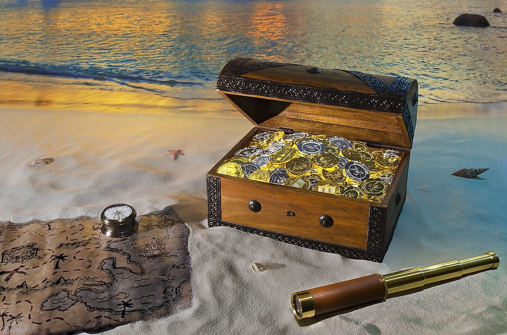

# Treasure Hunt Time

## Summary

**Treasure Hunt Time** is an entry-level OSINT challenge authored by Mimiro Kacelia for the CyberPH CTF competition. The challenge presents a stock-style treasure chest image accompanied by a will-related lore premise. While traditional metadata extraction presents an explicit red-herring comment, solving the challenge requires identifying the naming convention anomaly in the image filename (`treasurehunttrip`) as a three-word address on [what3words](https://what3words.com/). Mapping the corresponding 3-meter grid location yields geographic coordinates, which translate into degrees and minutes (DMS) to construct the final flag.

---

## Challenge Overview & Objective

- **Event:** CyberPH CTF
- **Author:** Mimiro Kacelia
- **Category:** OSINT / CTF
- **Difficulty:** Easy
- **Provided Artifact:** `treasurehunttrip.jpg` (stock treasure chest image)
- **Flag Format:** `PacketCapture{00.00, 00.00}` (representing coordinate degrees and minutes `DD.MM, DD.MM`)



---

## 1. Reconnaissance & Artifact Inspection

Initial analysis begins by inspecting file properties and embedded EXIF metadata using `exiftool` on the local machine:

```bash
exiftool treasurehunttrip.jpg
```

### Metadata Output

```text
ExifTool Version Number         : 13.50
File Name                       : treasurehunttrip.jpg
File Size                       : 280 kB
File Type                       : JPEG
MIME Type                       : image/jpeg
Comment                         : If you're looking here, then you've searched yourself into a wrong hole.
Image Size                      : 1300x861
Megapixels                      : 1.1
```

### Analysis & Triage

1. **Red Herring Identified:** The embedded JPEG comment explicitly states:
   > `If you're looking here, then you've searched yourself into a wrong hole.`
2. Further inspection of EXIF tags reveals no embedded GPS tags (`GPS Latitude`, `GPS Longitude`), hidden thumbnail overlays, or steganographic markers.
3. The image file title itself—`treasurehunttrip`—stands out as an anomaly: three concatenated dictionary words without punctuation, delimiters, or grammatical conjunctions (`treasure`, `hunt`, `trip`).

---

## 2. Geolocation Resolution via what3words

The three-word compound points directly to the addressing scheme of **[what3words](https://what3words.com/)**, a global coordinate system that encodes geographic locations into unique three-word identifiers separated by periods.

### Step-by-Step Resolution

1. **Query Construction:** Convert `treasurehunttrip` into standard 3-word format:
   ```text
   ///treasure.hunt.trip
   ```
2. **Platform Search:** Inputting `treasure.hunt.trip` into `what3words.com` resolves to a distinct 3m × 3m grid square in an isolated geographic region.
3. **Coordinate Extraction:** Selecting **Navigate > Google Maps** opens the geographic marker and displays decimal degree coordinates.
4. **DMS Conversion:** Searching the decimal coordinates or inspecting the map datum outputs standard Degrees, Minutes, Seconds (DMS):
   ```text
   S 85° 36' 00" W 081° 05' 28"
   ```

Following the challenge specification:
- Degree and minute values of each coordinate: `DD.MM`
- Latitude: `85° 36'` $\rightarrow$ `85.36`
- Longitude: `081° 05'` $\rightarrow$ `81.05`

---

## 3. Flag Construction

Combining the formatted degree-minute coordinates into the target flag template:

| Coordinate Element | Value | Flag Fragment |
| :--- | :--- | :--- |
| Latitude (DMS) | `S 85° 36' 00"` | `85.36` |
| Longitude (DMS) | `W 081° 05' 28"` | `81.05` |
| **Complete Flag** | `PacketCapture{85.36, 81.05}` | `PacketCapture{REDACTED}` |

> *OPSEC Note: In accordance with repository standards, live flag strings are redacted in public documentation (`PacketCapture{REDACTED}`).*

---

## Lessons Learned & Key Takeaways

1. **Recognize Filename Anomalies:** Metadata is not confined to file headers and EXIF fields; filenames, directory paths, and archive names often serve as primary OSINT breadcrumbs.
2. **Triage Red Herrings Efficiently:** Misdirection in challenge comments should prompt immediate pivoting to external artifacts rather than excessive deep-rabbit-hole stego analysis.
3. **Leverage Alternative Geocoding Systems:** Geolocation challenges frequently utilize modern geocoding platforms such as what3words, Plus Codes (Open Location Code), or military grid reference systems (MGRS) alongside traditional GPS coordinates.

---

## References

- [what3words Geocoding System](https://what3words.com/)
- [ExifTool by Phil Harvey](https://exiftool.org/)
- [CyberPH CTF](https://cyberph.org/)
