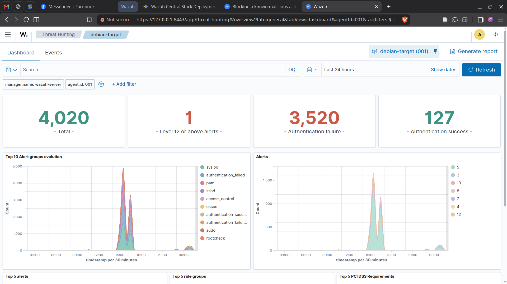
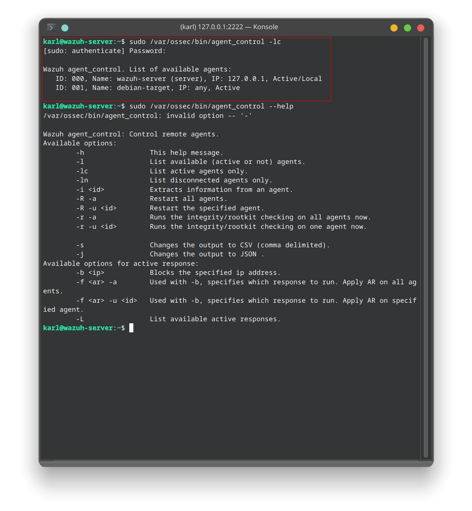
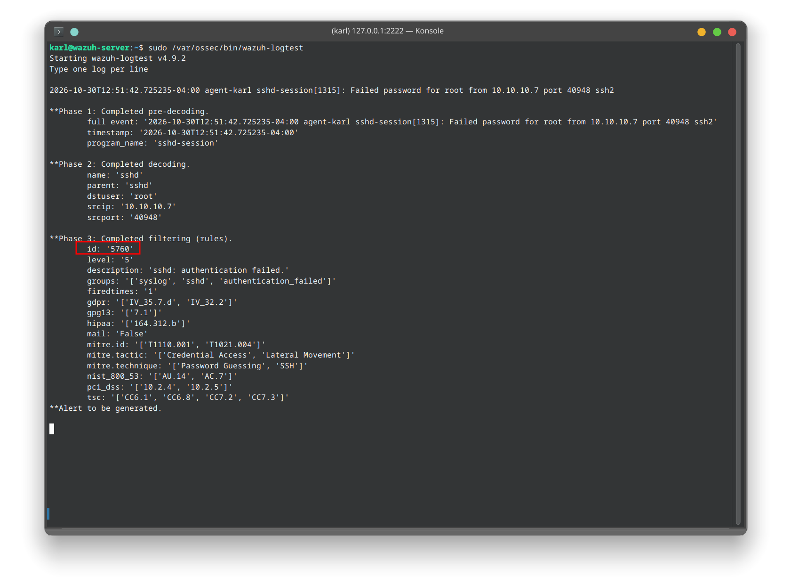
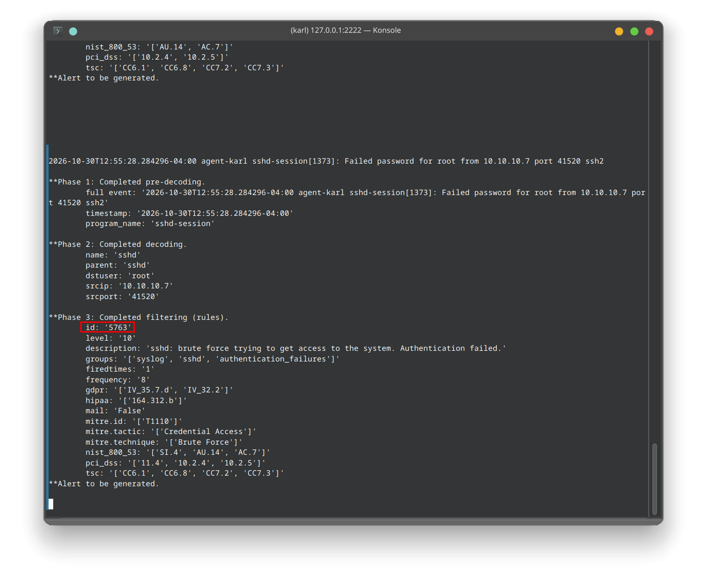
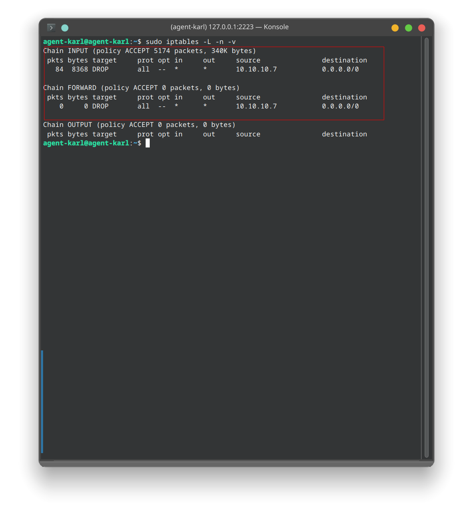
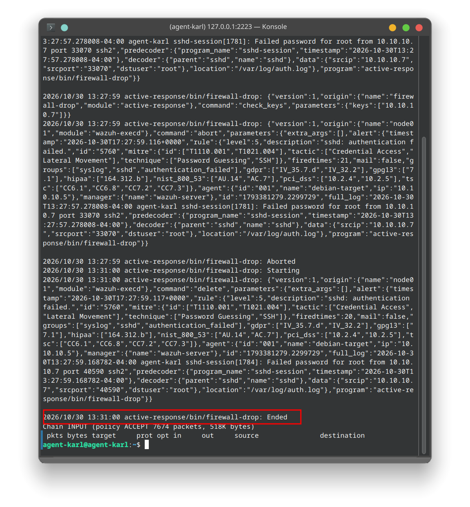
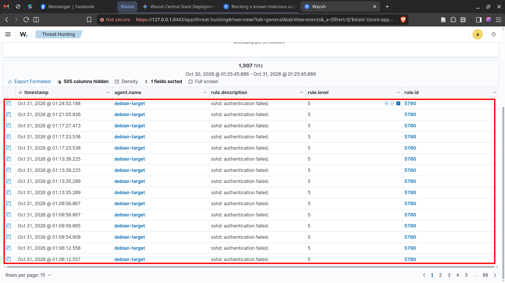
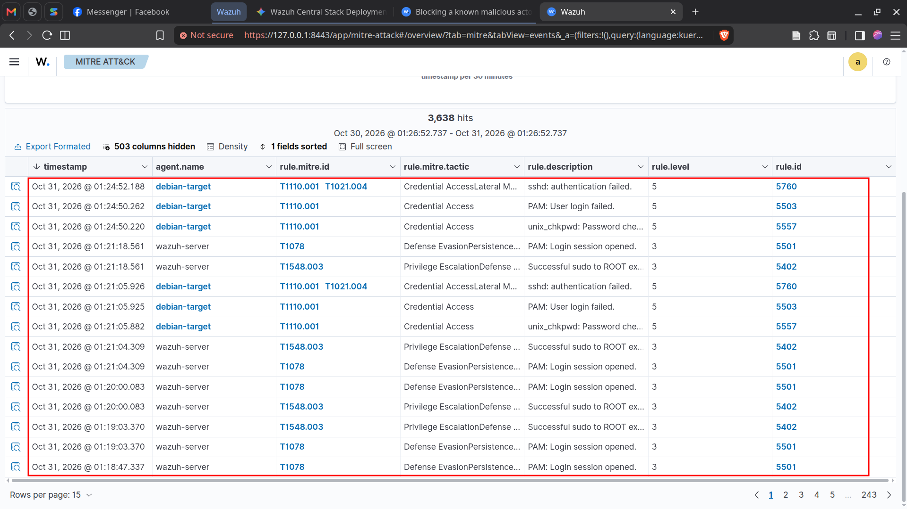

# Host-Based Telemetry and Dynamic Defense: An End-to-End Proof of Concept for SSH Brute-Force Detection in Wazuh

---


## 1. Executive Summary

This Proof of Concept (PoC) explores the detection, alerting, and automated mitigation capabilities of Wazuh SIEM against an automated SSH dictionary brute-force attack.

Modern environments require fast, reliable visibility into unauthorized access attempts. Using an isolated lab setup consisting of an Attacker (Kali Linux), an Audited Host running a Wazuh Agent (Debian 12), and a centralized Wazuh Manager, this writeup details:
- How endpoint telemetry travels across the agent-manager communication boundary.
- Real-world log pipeline troubleshooting, specifically covering journald persistence versus legacy `auth.log`, as well as modern OpenSSH `sshd-session` decoder mappings.
- Automated host mitigation through Wazuh Active Response (`firewall-drop`).
- Cooldown verification showing the automatic removal of temporary firewall rules.
- SIEM correlation and MITRE ATT&CK mapping inside the Wazuh Dashboard.

---

## 2. Lab Environment and Architecture

The lab setup is isolated inside an internal virtual network (`10.10.10.0/24`).

| Role | Hostname / Identifier | IP Address | Operating System | Key Components / Services |
| :--- | :--- | :--- | :--- | :--- |
| **Attacker** | `kali-attacker` | `10.10.10.7` | Kali Linux | Hydra, `rockyou.txt` dictionary |
| **Target / Monitored Host** | `debian-target` (`agent-karl` / ID `001`) | `10.10.10.5` | Debian 12 (Bookworm) | OpenSSH (`sshd-session`), Wazuh Agent, `rsyslog`, `iptables` |
| **SIEM Server** | `wazuh-manager` | `10.10.10.10` | Linux VM | Wazuh Manager, Wazuh Indexer, Wazuh Dashboard |

  
*Figure 1: Lab Topology and Wazuh Dashboard showing Agent 001 in Active state.*

---

## 3. High-Level Agent to Manager Interaction Flow

Understanding the communication cycle between the Wazuh Agent and Wazuh Manager is essential for understanding how host-based intrusion detection functions:

```
[Attacker: 10.10.10.7]
         | (SSH Brute Force: port 22)
         v
[Debian Target (Wazuh Agent)]
  +-- 1. sshd-session writes failed attempts to /var/log/auth.log via rsyslog
  +-- 2. wazuh-logcollector monitors /var/log/auth.log
  +-- 3. wazuh-agentd encrypts and streams log events to TCP port 1514
         |
         v
[Wazuh Manager]
  +-- 4. wazuh-analysisd decodes the log (Debian sshd-session decoder)
  +-- 5. Correlates events against detection rules (Rule 5760 to Rule 5763)
  +-- 6. Writes alerts to alerts.json and indexes them for the Dashboard
  +-- 7. Triggers Active Response directive and dispatches instruction over TCP 1514
         |
         v
[Debian Target (Wazuh Agent)]
  +-- 8. wazuh-execd receives manager instruction
  +-- 9. Invokes /var/ossec/active-response/bin/firewall-drop
        --> Attacker IP (10.10.10.7) dropped at the kernel level via iptables
```

---

## 4. Phase 1: Initial Configuration and Baselining

### 4.1 Wazuh Manager Configuration
The detection and response logic resides on the Wazuh Manager (`10.10.10.10`). In `/var/ossec/etc/ossec.conf`:

1. **Verify Default Command Definition**:  
   Wazuh includes standard response executables out of the box. Confirm the `firewall-drop` definition exists:
   ```xml
   <command>
     <name>firewall-drop</name>
     <executable>firewall-drop</executable>
     <timeout_allowed>yes</timeout_allowed>
   </command>
   ```

2. **Active Response Trigger Definition**:  
   Add the trigger specifying the target rule IDs and `<location>local</location>`:
   ```xml
   <active-response>
     <command>firewall-drop</command>
     <location>local</location>
     <rules_id>5710, 5712, 5760, 5763</rules_id>
     <timeout>180</timeout>
   </active-response>
   ```
   > **Architecture Note on `<location>local</location>`**:  
   > In Wazuh, configuring `<location>local</location>` on the manager instructs it to execute the script on the specific host that generated the event. If Agent `001` experiences the attack, the manager dispatches the execution command to Agent `001`.

3. Restart the manager service:
   ```bash
   sudo systemctl restart wazuh-manager
   ```

### 4.2 Target Agent Configuration
The Wazuh Agent (`10.10.10.5`) requires minimal configuration because it operates as an execution receiver rather than a detection engine.

1. **Enable Active Response Receiver**:  
   Inside `/var/ossec/etc/ossec.conf` on the agent, verify active response is enabled:
   ```xml
   <active-response>
     <disabled>no</disabled>
   </active-response>
   ```
   *(Note: The agent does not require `<command>` or `<rules_id>` declarations; it receives instructions from the manager through `wazuh-execd`.)*

2. **Verify Tooling and Permissions**:  
   - Confirm executable permissions on the local script:
     ```bash
     ls -la /var/ossec/active-response/bin/firewall-drop
     ```
   - Ensure the host has firewall binaries installed (`iptables` / `nftables`):
     ```bash
     sudo which iptables
     ```

---

## 5. Phase 2: Initial Simulation and Telemetry Troubleshooting

### 5.1 The Initial Attack Run
From the Kali Linux host (`10.10.10.7`), the tester launched an automated dictionary attack against the target SSH service using Hydra:

```bash
hydra -l root -P /usr/share/wordlists/rockyou.txt -t 4 ssh://10.10.10.5 -s 22
```

While Hydra actively fired authentication attempts against port 22, an initial review of the Wazuh Manager revealed that zero alerts were generated and no defensive actions took place on the endpoint. 

Investigating why the SIEM failed to detect ongoing brute-force traffic led to two underlying configuration mismatches.

---

### 5.2 Root Cause Analysis and Engineering Fixes

#### Issue A: Missing Persistent Syslog on Modern Debian
When checking why `wazuh-logcollector` remained idle on the Debian target, an inspection of `/var/log/auth.log` revealed that the file did not exist.

Debian 12 minimal installations log strictly into the in-memory `systemd-journald` buffer by default. Without an active syslog daemon, authentication events are never written to disk for standard file log collectors.

1. **Install rsyslog** on the agent:
   ```bash
   sudo apt update && sudo apt install -y rsyslog
   sudo systemctl enable --now rsyslog
   ```
   Once started, `/var/log/auth.log` was created immediately and began recording incoming SSH login attempts.

2. **Configure log collection** in the agent's `/var/ossec/etc/ossec.conf`:
   ```xml
   <localfile>
     <log_format>syslog</log_format>
     <location>/var/log/auth.log</location>
   </localfile>
   ```

3. Restart `wazuh-agent`:
   ```bash
   sudo systemctl restart wazuh-agent
   ```
   Checking `/var/ossec/logs/ossec.log` confirmed that `wazuh-logcollector` successfully attached to `/var/log/auth.log`.

#### Issue B: OpenSSH Architecture Changes (sshd vs sshd-session)
Once logs were actively streaming from the agent to the manager, the default legacy SSH detection rules (Rule 5710 for single failures and Rule 5712 for brute-force attempts) still failed to trigger an Active Response block.

To inspect how the manager decoded incoming events, actual log lines from `/var/log/auth.log` were passed through the manager testing tool:
```bash
/var/ossec/bin/wazuh-logtest
```

  
  
*Figure 2: wazuh-logtest confirming matching rules 5760 and 5763.*

The tool highlighted a shift in modern Debian and OpenSSH. The operating system now isolates login handshakes into a dedicated process named `sshd-session` instead of legacy `sshd`. Because the process name differed, Wazuh evaluated them against newer decoders:
- **Rule 5760**: Single authentication failure (`sshd: authentication failed`).
- **Rule 5763**: Brute-force threshold breach (`sshd: brute force trying to get access to the system`).

Because the active-response block on the manager was originally configured to track only legacy rules 5710 and 5712, the manager recorded the events but never dispatched a drop instruction.

**The Fix**: Update `/var/ossec/etc/ossec.conf` on the Wazuh Manager to include modern and legacy rule IDs:
```xml
<active-response>
  <command>firewall-drop</command>
  <location>local</location>
  <rules_id>5710, 5712, 5760, 5763</rules_id>
  <timeout>180</timeout>
</active-response>
```
Followed by restarting the manager:
```bash
sudo systemctl restart wazuh-manager
```

---

## 6. Phase 3: Attack Execution, Mitigation, and Cooldown

With log ingestion working and rule evaluation updated, the attack was repeated from Kali Linux.

### 6.1 Attack Launch and Automated Drop
```bash
hydra -l root -P /usr/share/wordlists/rockyou.txt -t 4 ssh://10.10.10.5 -s 22
```

Upon reaching the failure frequency threshold, the target machine automatically severed incoming traffic. Subsequent authentication attempts stalled immediately as the endpoint kernel began dropping packets from `10.10.10.7`.

---

### 6.2 Host-Side Enforcement (Debian Target)
On `debian-target` (`10.10.10.5`), the Active Response log verified that the script was invoked:

```bash
sudo tail -n 10 /var/ossec/logs/active-responses.log
```
*Log output:*
```text
Thu Oct 30 22:45:10 UTC 2026 /var/ossec/active-response/bin/firewall-drop add - 10.10.10.7 1730328310.12456 5760
```

Inspecting the kernel firewall rules revealed the drop rule actively matching traffic:
```bash
sudo iptables -L INPUT -n -v
```
*Output showing dropped packets accumulating:*
```text
Chain INPUT (policy ACCEPT 120 packets, 9840 bytes)
 pkts bytes target     prot opt in     out     source               destination         
   48  2880 DROP       all  --  *      *       10.10.10.7           0.0.0.0/0           
```

  
*Figure 3: Debian terminal showing active-responses.log and iptables drop counters.*

---

### 6.3 Automated Ban Expiration (Timeout Verification)
Because `<timeout>180</timeout>` was declared in the manager configuration, the ban is temporary by design to avoid permanent lockouts or rule clutter.

After three minutes elapsed, the host log recorded the script conclusion on `debian-target`:

```bash
sudo tail -n 10 /var/ossec/logs/active-responses.log
```
*Log confirmation of script completion:*
```text
... /var/ossec/active-response/bin/firewall-drop: ENDED
```

Running `sudo iptables -L INPUT -n -v` confirmed that the drop rule for `10.10.10.7` was removed from the `INPUT` chain, restoring network reachability.

  
*Figure 4: Log confirmation of firewall-drop completion (ENDED) and iptables rule teardown.*

---

## 7. Phase 4: Telemetry Analysis and SIEM Dashboard Verification

### 7.1 CLI Telemetry Inspection (Wazuh Manager)
On the manager, querying `/var/ossec/logs/alerts/alerts.json` with `jq` revealed structured JSON telemetry:

1. **Authentication Failure (Rule 5760)**:
   - `data.srcip`: `10.10.10.7`
   - `data.dstuser`: `root`
   - `rule.description`: `sshd: authentication failed.`
2. **Brute-Force Bursts (Rule 5763)**:
   - `rule.level`: `10`
   - `rule.description`: `sshd: brute force trying to get access to the system.`
3. **Active Response Action (Rule 651)**:
   - `data.command`: `firewall-drop`
   - `data.action`: `add`

### 7.2 Wazuh Web Dashboard
Logging into the Wazuh Web Interface (`https://127.0.0.1:8443`):

1. **Threat Hunting and Events**:  
   Under **Threat Hunting > Events**, filtering by `data.srcip: "10.10.10.7"` shows the chronological sequence of failed logins leading up to the high-severity alert.

2. **MITRE ATT&CK Mapping**:  
   The built-in MITRE ATT&CK dashboard highlights the activity across standard enterprise tactics:
   - **T1110 (Brute Force / Password Guessing)** under *Credential Access*.
   - **T1078 (Valid Accounts)** under *Initial Access* and *Privilege Escalation*.

  

  

*Figure 5: Wazuh Dashboard MITRE ATT&CK widget and Threat Hunting events list.*

---

## 8. Key Takeaways and Recommendations

1. **Log Subsystem Parity**:  
   Modern Linux distributions increasingly favor volatile in-memory journal buffers. When rolling out endpoint agents, administrators should ensure a syslog daemon like `rsyslog` is present or configure direct socket collection.

2. **Decoder Rule Drift**:  
   Changes in core system binaries (such as OpenSSH delegating sessions to `sshd-session`) can alter decoder matches. Using `wazuh-logtest` is a fast way to validate that active-response rules align with the actual logs generated by target endpoints.

3. **Defense in Depth**:  
   While automated temporary drops help mitigate aggressive scanning, SSH services should also be hardened at the configuration level:
   - Disable password-based authentication in favor of SSH public keys (`PasswordAuthentication no`).
   - Move management interfaces behind a VPN or bastion host.
   - Implement rate limiting at perimeter firewalls.
